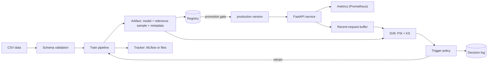

# Driftwatch

**An MLOps loop for a tabular classifier: train, track, register, serve, detect drift, and decide
when to retrain, with every decision logged.**

Models degrade quietly when the data they see stops resembling the data they learned from.
Driftwatch keeps the pieces that make that visible in one small, readable codebase: a
config-driven training pipeline, a registry with a gated promotion rule, a serving API that
exports Prometheus metrics, per-feature drift statistics, and a retraining policy whose decisions
are written to an audit log.

## Status

Implementation and test suite are included. **No benchmarks or model performance results are
published**, no model is shipped, and the Docker stack has been written but not run end to end.
The bundled demo data is **synthetic and invented**. See [Limitations](#limitations).

## Features

| Area | What it does |
| --- | --- |
| Data | Schema validation (types, nulls, ranges) that reports every problem at once |
| Training | scikit-learn pipeline (scaling, one-hot, logistic regression or random forest), stratified split, seeded |
| Tracking | MLflow when a URI is set, otherwise a dependency-free file tracker behind the same interface |
| Registry | Versioned artifacts and a `production` stage, with a log of every promotion and rollback |
| Promotion gate | Promote only if the candidate beats production by a configured margin on a chosen metric |
| Serving | FastAPI `/predict`, `/health`, `/metrics`, `/drift`; the model version is in every response |
| Drift | PSI and a two-sample KS test per feature, plus prediction and label drift |
| Trigger policy | Retrain on feature alerts, repeated warnings, prediction alerts or model age; every decision logged |
| Demo data | Seeded synthetic generator with controllable feature and label drift |

## Architecture



See [docs/ARCHITECTURE.md](docs/ARCHITECTURE.md) and the decision records in
[docs/adr](docs/adr). The full list of documents is in [docs/index.md](docs/index.md).

## Quick start

```bash
pip install -e ".[dev]"

# Synthetic data: a reference set and a drifted "production" set
driftwatch simulate --output data/reference.csv --n 5000 --seed 1
driftwatch simulate --output data/current.csv   --n 1000 --seed 2 --drift 1.0

# Train, register, promote
driftwatch train    --data data/reference.csv --artifact-dir artifacts/v1
driftwatch register --name churn-demo --artifact-dir artifacts/v1
driftwatch promote  --name churn-demo --version 1

# Compare current data with the training reference, then decide
driftwatch drift  --artifact-dir artifacts/v1 --current data/current.csv
driftwatch decide --artifact-dir artifacts/v1 --current data/current.csv --fail-on-retrain

# Serve the production model
driftwatch serve --name churn-demo
curl -s localhost:8000/health

# Undo a bad release (bypasses the gate, needs a reason, is logged)
driftwatch rollback --name churn-demo --version 1 --reason "version 2 regressed"
```

Run the commands from the repository root, or pass `--config` (before the command) with the path to
a settings file. Exit codes: `promote` and `rollback` return 2 when refused; `decide
--fail-on-retrain` returns 3 when retraining is recommended, so it can drive a scheduled job. See
[docs/CLI.md](docs/CLI.md).

### Calling the API

```bash
curl -s localhost:8000/predict -H 'content-type: application/json' -d '{
  "records": [{"tenure_months": 6, "monthly_spend": 80, "support_calls": 4, "plan": "basic"}]
}'
```

Missing or null features return `422` with the offending names. `GET /drift` compares the most
recent requests (a bounded in-memory buffer) with the training reference and reports
`insufficient_data` until `min_samples` requests have arrived.

### Docker

```bash
export GRAFANA_ADMIN_PASSWORD=choose-one
docker compose up --build
```

The stack (API, MLflow, Prometheus, Grafana) is defined in `docker-compose.yml` and is **untested**.
The API refuses to start until the registry contains a production version.

## Configuration

All thresholds live in [`config/default.yaml`](config/default.yaml):

```yaml
drift:     { bins: 10, psi_warn: 0.1, psi_alert: 0.25, ks_alpha: 0.05, min_samples: 200 }
promotion: { metric: f1, margin: 0.01, min_absolute: 0.0 }
trigger:   { alert_features: 1, warn_features: 3, schedule_days: 30, prediction_drift_alert: true }
```

The PSI cut-offs are conventional rules of thumb, not statistical guarantees. Tune them per
feature and sample size. Every setting and environment variable is documented in
[docs/CONFIGURATION.md](docs/CONFIGURATION.md), and the serving API in [docs/API.md](docs/API.md).

## Project layout

```text
src/driftwatch/
  config.py      typed settings
  data.py        schema validation
  synthetic.py   seeded synthetic data with drift
  train.py       pipeline, metrics, artifact format
  tracking.py    MLflow and file trackers
  registry.py    versions, stages, promotion gate
  drift.py       PSI, KS, drift report
  policy.py      retraining triggers and decision log
  serving.py     FastAPI app and Prometheus metrics
  cli.py         command line
config/          default settings
deploy/          Prometheus and Grafana provisioning
tests/           pytest suite
docs/            architecture and decision records
MODEL_CARD.md    template for documenting a trained model
```

## Limitations

- **Synthetic demo data only.** The generator is invented to exercise the code; nothing here says
  anything about a real population or a real model's accuracy.
- **Univariate drift.** PSI and KS look at one feature at a time and miss changes in feature
  relationships.
- **Label drift needs labels.** The serving buffer holds features and scores, not outcomes, so
  label drift is only computed when you supply data that includes the target.
- **Buffer is in memory.** `/drift` sees only the last `buffer_size` requests of one process; it
  resets on restart and is not shared across replicas.
- **File registry.** Suitable for one machine or a mounted volume, not for concurrent writers.
- **Restart after a promotion.** The service loads the production version once at start-up.
- **No API authentication.** Keep the service on an internal network.
- **Pickle-based artifacts.** `joblib` loads pickles; only load artifacts you produced.
- **Binary classification only**, with a fixed 0.5 decision threshold in the API.
- **Not evaluated.** No measured results exist. The test suite and CI configuration have not yet
  been executed in a clean environment, and the Docker stack has not been run.

## Roadmap

- Multivariate and embedding drift, and per-feature thresholds.
- Delayed-label ingestion for label drift and live performance tracking.
- Persistent buffer or streaming ingestion shared across replicas.
- Dashboards for Grafana and alert rules for Prometheus.
- Shadow and canary serving of a candidate model.
- Real-dataset case study with published method and results.

## Development

```bash
make install
make check     # ruff, mypy, pytest
```

See [docs/DEVELOPMENT.md](docs/DEVELOPMENT.md). Security notes are in [SECURITY.md](SECURITY.md).

## License

MIT, see [LICENSE](LICENSE).
