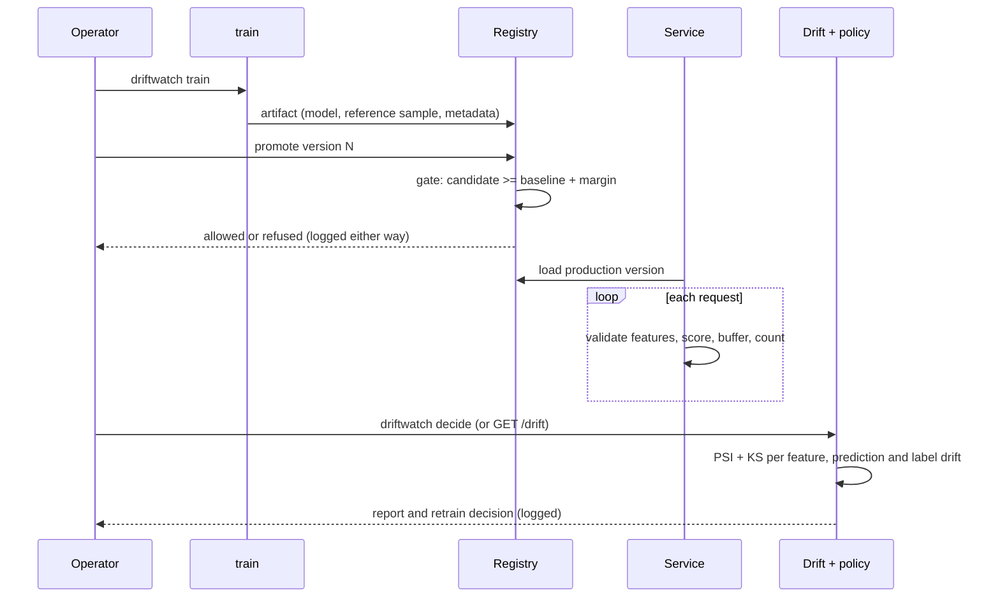
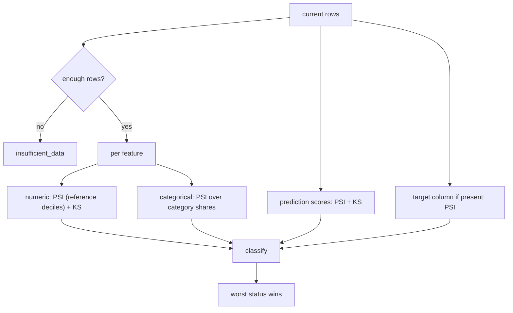

# Architecture

## Lifecycle



## Components

| Module | Responsibility |
| --- | --- |
| `config` | Pydantic models for schema, training, drift, promotion and trigger settings; validates relationships such as `psi_warn < psi_alert` |
| `data` | Collects all schema violations rather than failing on the first |
| `train` | Fits the pipeline, evaluates on a held-out split, writes `model.joblib`, `reference.csv` and `metadata.json` |
| `tracking` | `Tracker` protocol with `FileTracker` and `MlflowTracker`; MLflow is imported lazily |
| `registry` | Copies artifacts into numbered versions, stores the `production` stage, appends every promotion or rollback attempt to `decisions.jsonl` |
| `drift` | Pure functions for PSI and KS, and `detect_drift` which assembles a `DriftReport` |
| `policy` | Pure `decide_retraining` plus an append-only `DecisionLog` |
| `serving` | `create_app` takes any object satisfying `ServingModel`, so the API is testable without scikit-learn |
| `cli` | Thin wrapper; exit codes carry decisions for use in schedulers |

## Artifact format

```text
<artifact>/
  model.joblib     fitted scikit-learn Pipeline (pickle)
  reference.csv    sample of the training rows (the drift baseline)
  metadata.json    created_at, metrics, features, target, model_type, seed
```

The reference sample travels with the model so drift is always measured against what *that*
model was trained on.

## Drift computation



Classification: `alert` when PSI >= `psi_alert`; `warn` when PSI >= `psi_warn` or the KS p-value
is below `ks_alpha`; otherwise `ok`. KS alone never raises an alert (see ADR 0001).

## Metrics exported

| Metric | Type | Meaning |
| --- | --- | --- |
| `driftwatch_predictions_total{model_version}` | counter | Rows scored |
| `driftwatch_rejected_requests_total` | counter | Requests refused for missing or null features, or unscorable input |
| `driftwatch_predict_seconds` | histogram | `/predict` latency |
| `driftwatch_model_info{model_version}` | gauge | Which version is serving |
| `driftwatch_feature_psi{feature}` | gauge | PSI from the most recent `/drift` call |

Each app instance owns its own `CollectorRegistry`, so tests and multiple apps never collide on
metric names.

## Failure behaviour

- Invalid training data: `DataValidationError` listing every problem; nothing is written.
- Unknown model version or bad name (names must start with a letter or digit): `RegistryError`.
- Rollback without a reason, or to an unknown version: `RegistryError`. Rollback to the version
  already in production is refused and logged.
- Current data with missing feature columns or null values: `DataValidationError` before scoring.
- Missing features at serving time: HTTP 422 with names, counted in the rejected metric.
- Too little traffic for drift: `insufficient_data`, never a verdict from noise.
- No production version at start-up: the service refuses to start with an explanatory error.
